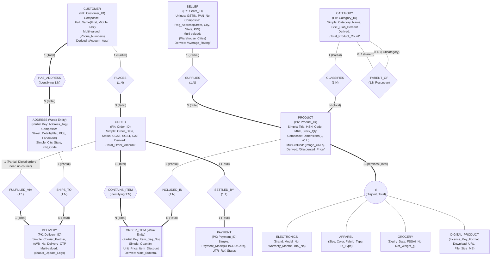

# Question 1: ER Diagram Design for an Indian E-Commerce Platform

**Problem Statement:**  
Design an Entity-Relationship (ER) / Enhanced Entity-Relationship (EER) diagram for an Indian e-commerce platform with entities **Customer**, **Product**, **Order**, **OrderItem**, **Seller**, **Category**, **Payment**, **Delivery**, and **Address**. Specify primary keys, composite and multi-valued attributes, weak entities, specialization of **Product**, and participation constraints.

## 1. Aim

To design and model a comprehensive Enhanced Entity-Relationship (EER) diagram for an Indian e-commerce platform incorporating core business entities (**Customer**, **Product**, **Order**, **OrderItem**, **Seller**, **Category**, **Payment**, **Delivery**, and **Address**), along with Indian market-specific attributes (such as GSTIN, HSN codes, PIN codes, UPI/COD payment modes, and regional address structures), and to specify all primary/partial keys, composite and multi-valued attributes, weak entities, product specialization hierarchies, and structural participation constraints.

## 2. Objectives

1. **Identify Core & Weak Entities:** Define strong entities (**Customer**, **Seller**, **Category**, **Product**, **Order**, **Payment**, **Delivery**) and weak entities (**OrderItem**, **Address**) along with their respective primary keys and partial keys (discriminators).
2. **Model Attribute Types:** Represent simple, composite (e.g., `Customer.Full_Name`, `Seller.Registered_Address`), multi-valued (e.g., `Customer.Phone_Numbers`, `Product.Image_URLs`, `Seller.Warehouse_Cities`), and derived attributes (e.g., `Order.Total_Order_Amount`, `OrderItem.Line_Subtotal`).
3. **Establish EER Specialization / Generalization:** Model the top-down specialization of the **Product** superclass into domain-specific subclasses (**Electronics**, **Apparel**, **Grocery**, and **Digital_Product**) using disjointness and completeness constraints.
4. **Define Relationships, Cardinalities & Participation Constraints:** Specify binary and identifying relationships (`1:1`, `1:N`, `M:N` resolved via an associative weak entity) and enforce total (`===`) versus partial (`---`) participation constraints across all entities.
5. **Translate to Relational Schema (Output):** Map the conceptual EER model into a normalized relational database schema (3NF/BCNF) with foreign key constraints suitable for implementation in an RDBMS.

## 3. Input

The input to the database design process consists of the system requirements, business rules for an Indian e-commerce platform, entity specifications, attribute classifications, specialization rules, and structural constraints.

### 3.1 Input Business Rules (Indian E-Commerce Context)

1. **Customers & Addresses:** Every customer registers with a unique `Customer_ID` and email, can have multiple contact phone numbers, and stores one or more delivery/billing addresses identified by an `Address_Tag` (e.g., `"Home"`, `"Office"`) scoped to that customer, including a 6-digit Indian `PIN_Code`, `State`, `District`, and `Locality`.
2. **Sellers & GST Compliance:** Every registered seller has a unique `Seller_ID`, a mandatory 15-character Indian `GSTIN` (Goods and Services Tax Identification Number), a PAN number, and may operate from multiple warehouse locations.
3. **Categories & Hierarchical Catalog:** Products are organized into categories (`Category_ID`), where a category may have a parent category (self-referencing hierarchy) and an applicable `GST_Slab_Percent` (e.g., 5%, 12%, 18%, 28%).
4. **Product Specialization:** Every product belongs to a category and is listed by a seller with an `HSN_Code`. Products are specialized into mutually exclusive (disjoint) subclasses based on their domain attributes:
   - **Electronics:** Includes `Warranty_Months`, `Brand`, `Model_Number`, and `BIS_Certification_No`.
   - **Apparel:** Includes `Size`, `Color`, `Fabric_Type`, and `Fit_Type`.
   - **Grocery:** Includes `Expiry_Date`, `FSSAI_License_No`, `Net_Weight_Grams`, and `Is_Perishable`.
   - **Digital_Product:** Includes `License_Key_Format`, `Download_URL`, and `File_Size_MB`.
5. **Orders & Order Items:** A customer places zero or more orders (`Order_ID`). Each order must contain at least one line item (**OrderItem**), which is a weak entity identified by `Item_Seq_No` together with `Order_ID`.
6. **Payments (UPI / NetBanking / Card / COD):** Each order is settled via a payment record (`Payment_ID`) capturing Indian payment modes (`UPI`, `Credit_Card`, `Debit_Card`, `Net_Banking`, `EMI`, `COD`), `UTR_or_Txn_Ref`, and payment status.
7. **Delivery & Logistics:** Each physical order has a shipment/delivery record (`Delivery_ID`) with `AWB_Tracking_No`, `Courier_Partner` (e.g., Delhivery, BlueDart, Ekart), `Delivery_Status`, and `Delivery_OTP` linked to a specific customer delivery address.

### 3.2 Input Entity & Attribute Specifications

| Entity Name | Entity Type | Primary / Partial Key | Composite Attributes | Multi-Valued Attributes | Derived Attributes | Simple / Other Attributes |
| :--- | :--- | :--- | :--- | :--- | :--- | :--- |
| **Customer** | Strong Entity | `Customer_ID` (PK) | `Full_Name` (`First_Name`, `Middle_Name`, `Last_Name`) | `{Phone_Numbers}` | `Account_Age` (from `Registration_Date`) | `Email` (Unique), `Registration_Date`, `Is_Prime_Member` |
| **Address** | Weak Entity (Owner: **Customer**) | `Address_Tag` (Partial Key) + `Customer_ID` | `Street_Details` (`House_Flat_No`, `Building_Name`, `Street_Landmark`) | *None* | *None* | `Locality`, `City`, `District`, `State`, `PIN_Code` (6-digit), `Address_Type` (`Home`/`Work`) |
| **Seller** | Strong Entity | `Seller_ID` (PK) | `Registered_Address` (`Building`, `Street`, `City`, `State`, `PIN_Code`) | `{Warehouse_Cities}`, `{Contact_Phones}` | `Average_Rating` | `Business_Name`, `GSTIN` (15-digit Unique), `PAN_No`, `Bank_IFSC` |
| **Category** | Strong Entity | `Category_ID` (PK) | *None* | *None* | `Total_Product_Count` | `Category_Name`, `Description`, `GST_Slab_Percent`, `Parent_Category_ID` (FK) |
| **Product** | Strong Superclass Entity | `Product_ID` (PK) | `Dimensions` (`Length_cm`, `Width_cm`, `Height_cm`) | `{Image_URLs}`, `{Search_Tags}` | `Discounted_Price` (from `MRP`, `Discount_Pct`) | `Product_Title`, `MRP`, `Discount_Pct`, `Stock_Qty`, `HSN_Code`, `Product_Type` |
| **Order** | Strong Entity | `Order_ID` (PK) | *None* | *None* | `Total_Order_Amount`, `Total_GST_Amount` | `Order_Date`, `Order_Status`, `CGST_Amt`, `SGST_Amt`, `IGST_Amt` |
| **OrderItem** | Weak Entity (Owner: **Order**) | `Item_Seq_No` (Partial Key) + `Order_ID` | *None* | *None* | `Line_Subtotal` (`Quantity * Unit_Price - Item_Discount`) | `Quantity`, `Unit_Price_At_Purchase`, `Item_Discount`, `Applied_GST_Rate` |
| **Payment** | Strong Entity | `Payment_ID` (PK) | *None* | *None* | *None* | `Payment_Mode` (`UPI`/`Card`/`NetBanking`/`COD`), `UTR_or_Txn_Ref`, `Payment_Date`, `Amount_Paid`, `Payment_Status` |
| **Delivery** | Strong Entity | `Delivery_ID` (PK) | *None* | `{Status_Update_Logs}` | `Estimated_Days_Remaining` | `Courier_Partner`, `AWB_Tracking_No`, `Dispatch_Date`, `Delivered_Date`, `Delivery_OTP`, `Delivery_Status` |

## 4. ER & EER Diagrams

### 4.1 Crow's Foot Relational ER Diagram

The diagram below illustrates all nine core entities, the four specialized subclasses of **Product**, their attributes, primary keys (`PK`), foreign keys (`FK`), and cardinality/participation notations.

```mermaid
erDiagram
    CUSTOMER ||--o{ ORDER : "places (0..N)"
    CUSTOMER ||--|{ ADDRESS : "has_address (identifying 1..N)"
    ORDER ||--|{ ORDER_ITEM : "contains (identifying 1..N)"
    PRODUCT ||--o{ ORDER_ITEM : "included_in (0..N)"
    SELLER ||--o{ PRODUCT : "supplies (0..N)"
    CATEGORY ||--o{ PRODUCT : "classifies (0..N)"
    CATEGORY |o--o{ CATEGORY : "subcategorizes (0..N)"
    ORDER ||--|| PAYMENT : "settled_by (1..1)"
    ORDER ||--o| DELIVERY : "fulfilled_via (0..1)"
    ADDRESS ||--o{ DELIVERY : "ships_to (0..N)"

    PRODUCT ||--o| ELECTRONICS : "ISA (Disjoint)"
    PRODUCT ||--o| APPAREL : "ISA (Disjoint)"
    PRODUCT ||--o| GROCERY : "ISA (Disjoint)"
    PRODUCT ||--o| DIGITAL_PRODUCT : "ISA (Disjoint)"

    CUSTOMER {
        string Customer_ID PK
        string First_Name "Composite: Full_Name"
        string Middle_Name "Composite: Full_Name"
        string Last_Name "Composite: Full_Name"
        string Email UK
        string Phone_Numbers "Multi-valued {Phone_Numbers}"
        date Registration_Date
        int Account_Age "Derived"
    }

    ADDRESS {
        string Customer_ID PK, FK "Owner Key"
        string Address_Tag PK "Partial Key (Discriminator)"
        string House_Flat_No "Composite: Street_Details"
        string Building_Name "Composite: Street_Details"
        string Street_Landmark "Composite: Street_Details"
        string Locality
        string City
        string District
        string State
        string PIN_Code "6-digit Indian PIN"
    }

    SELLER {
        string Seller_ID PK
        string Business_Name
        string GSTIN UK "15-char Indian GSTIN"
        string PAN_No UK
        string Reg_Street "Composite: Registered_Address"
        string Reg_City "Composite: Registered_Address"
        string Reg_State "Composite: Registered_Address"
        string Reg_PIN_Code "Composite: Registered_Address"
        string Warehouse_Cities "Multi-valued {Warehouse_Cities}"
        float Average_Rating "Derived"
    }

    CATEGORY {
        string Category_ID PK
        string Category_Name
        float GST_Slab_Percent "5, 12, 18, or 28%"
        string Parent_Category_ID FK
        int Total_Product_Count "Derived"
    }

    PRODUCT {
        string Product_ID PK
        string Seller_ID FK
        string Category_ID FK
        string Product_Title
        string HSN_Code "Indian HSN Tariff Code"
        decimal MRP
        decimal Discount_Pct
        decimal Discounted_Price "Derived"
        int Stock_Qty
        string Length_Width_Height "Composite: Dimensions"
        string Image_URLs "Multi-valued {Image_URLs}"
        string Product_Type "Discriminator: ELEC/APPR/GROC/DIGI"
    }

    ELECTRONICS {
        string Product_ID PK, FK
        string Brand
        string Model_Number
        int Warranty_Months
        string BIS_Certification_No
    }

    APPAREL {
        string Product_ID PK, FK
        string Size
        string Color
        string Fabric_Type
        string Fit_Type
    }

    GROCERY {
        string Product_ID PK, FK
        date Expiry_Date
        string FSSAI_License_No
        int Net_Weight_Grams
        boolean Is_Perishable
    }

    DIGITAL_PRODUCT {
        string Product_ID PK, FK
        string License_Key_Format
        string Download_URL
        float File_Size_MB
    }

    ORDER {
        string Order_ID PK
        string Customer_ID FK
        datetime Order_Date
        string Order_Status
        decimal CGST_Amt
        decimal SGST_Amt
        decimal IGST_Amt
        decimal Total_Order_Amount "Derived"
    }

    ORDER_ITEM {
        string Order_ID PK, FK "Owner Key"
        int Item_Seq_No PK "Partial Key (Discriminator)"
        string Product_ID FK
        int Quantity
        decimal Unit_Price_At_Purchase
        decimal Item_Discount
        decimal Line_Subtotal "Derived"
    }

    PAYMENT {
        string Payment_ID PK
        string Order_ID FK, UK
        string Payment_Mode "UPI, Card, NetBanking, COD"
        string UTR_or_Txn_Ref
        datetime Payment_Date
        decimal Amount_Paid
        string Payment_Status
    }

    DELIVERY {
        string Delivery_ID PK
        string Order_ID FK, UK
        string Customer_ID FK
        string Address_Tag FK
        string Courier_Partner
        string AWB_Tracking_No UK
        string Delivery_OTP
        string Status_Update_Logs "Multi-valued {Status_Update_Logs}"
        string Delivery_Status
    }
```

### 4.2 Conceptual Chen / EER Notation Diagram (Weak Entities, Specialization & Participation)

The flowchart below explicitly highlights **Chen EER notation conventions**:
- **Double-bordered nodes (`[[...]]`)**: Weak entities (`ADDRESS`, `ORDER_ITEM`) and identifying relationships (`HAS_ADDR`, `CONTAINS_ITEM`).
- **Thick links (`===`)**: **Total participation** (existence or mandatory constraint).
- **Normal links (`---`)**: **Partial participation** (optional constraint).
- **Circle `(d)` node**: **Disjoint specialization** of `PRODUCT` into `ELECTRONICS`, `APPAREL`, `GROCERY`, and `DIGITAL_PRODUCT`.

## 5. Detailed Specification of ER Components

### 5.1 Primary Keys & Partial Keys

1. **Strong Entity Primary Keys (Underlined with solid line):**
   - `Customer`: **`Customer_ID`** (e.g., `CUST-IN-1001`)
   - `Seller`: **`Seller_ID`** (e.g., `SELL-IN-501`; candidate key: `GSTIN`)
   - `Category`: **`Category_ID`** (e.g., `CAT-ELEC-01`)
   - `Product`: **`Product_ID`** (e.g., `PROD-90012`)
   - `Order`: **`Order_ID`** (e.g., `ORD-2026-88412`)
   - `Payment`: **`Payment_ID`** (e.g., `PAY-UPI-77321`)
   - `Delivery`: **`Delivery_ID`** (e.g., `DEL-BLUEDART-3321`)
2. **Weak Entity Composite Primary Keys (Owner PK + Dashed Partial Key):**
   - `Address`: **`(Customer_ID, Address_Tag)`** where `Address_Tag` (or `Address_Seq_No`) is the **partial key / discriminator** (e.g., `("CUST-IN-1001", "HOME-01")`).
   - `OrderItem`: **`(Order_ID, Item_Seq_No)`** where `Item_Seq_No` is the **partial key / discriminator** numbering each line item (`1, 2, 3...`) within a specific order.

### 5.2 Composite, Multi-Valued, and Derived Attributes

- **Composite Attributes (decomposed into atomic sub-attributes):**
  1. `Customer.Full_Name` $\rightarrow$ `(First_Name, Middle_Name, Last_Name)`
  2. `Address.Street_Details` $\rightarrow$ `(House_Flat_No, Building_Name, Street_Landmark)`
  3. `Seller.Registered_Address` $\rightarrow$ `(Building_No, Street, City, State, PIN_Code)`
  4. `Product.Dimensions` $\rightarrow$ `(Length_cm, Width_cm, Height_cm)`
- **Multi-Valued Attributes (enclosed in curly braces `{ }` / double ovals):**
  1. `Customer.{Phone_Numbers}`: Customers frequently maintain both a primary mobile number (linked to UPI/OTP) and an alternate contact number.
  2. `Seller.{Warehouse_Cities}`: A single seller may dispatch inventory from fulfillment centers in multiple Indian hubs (e.g., Bhiwandi, Gurugram, Bengaluru).
  3. `Product.{Image_URLs}` and `Product.{Search_Tags}`: Multiple high-resolution gallery URLs and regional/English search keywords per product.
  4. `Delivery.{Status_Update_Logs}`: Timestamped transit checkpoints (e.g., `"Dispatched from Mumbai Hub"`, `"Arrived at Lucknow Sort Facility"`, `"Out for Delivery"`).
- **Derived Attributes (denoted by slash `/Attribute/` or dashed ovals):**
  1. `Customer./Account_Age/`: Computed dynamically from `CURRENT_DATE - Registration_Date`.
  2. `Product./Discounted_Price/`: Computed as $\text{MRP} \times \left(1 - \frac{\text{Discount\_Pct}}{100}\right)$.
  3. `OrderItem./Line_Subtotal/`: Computed as $(\text{Quantity} \times \text{Unit\_Price\_At\_Purchase}) - \text{Item\_Discount}$.
  4. `Order./Total_Order_Amount/`: Computed as $\sum \text{OrderItem.Line\_Subtotal} + \text{CGST\_Amt} + \text{SGST\_Amt} + \text{IGST\_Amt}$.

### 5.3 Weak Entities & Identifying Relationships

| Weak Entity | Owner (Strong) Entity | Identifying Relationship | Partial Key (Discriminator) | Full Primary Key | Justification |
| :--- | :--- | :--- | :--- | :--- | :--- |
| **OrderItem** | **Order** | `CONTAINS_ITEM` (`1:N`) | `Item_Seq_No` | `(Order_ID, Item_Seq_No)` | An order line item has no independent business existence outside its parent `Order`; deleting the `Order` cascades to delete its `OrderItem` records. |
| **Address** | **Customer** | `HAS_ADDRESS` (`1:N`) | `Address_Tag` | `(Customer_ID, Address_Tag)` | Saved customer addresses (`"Home"`, `"Parents' House"`, `"Office"`) are scoped to a specific customer account and identified relative to `Customer_ID`. |

### 5.4 Specialization / Generalization of `Product`

- **Superclass:** `Product` (`Product_ID`, `Product_Title`, `HSN_Code`, `MRP`, `Discount_Pct`, `Stock_Qty`, `Seller_ID`, `Category_ID`)
- **Specialization Criterion (Attribute-Defined on `Product_Type`):**
  - **Constraint Type:** **Disjoint (`d`) and Total (Double Line)** — Every listed product on the platform must belong to exactly one of the four operational fulfillment classes:
    1. **Electronics (`ISA Product`):** Adds `Brand`, `Model_Number`, `Warranty_Months`, and mandatory Indian `BIS_Certification_No` (Bureau of Indian Standards CRS mark).
    2. **Apparel (`ISA Product`):** Adds `Size` (`S/M/L/XL/XXL`), `Color`, `Fabric_Type` (e.g., Cotton, Silk, Khadi), and `Fit_Type`.
    3. **Grocery (`ISA Product`):** Adds `Expiry_Date`, mandatory Indian `FSSAI_License_No`, `Net_Weight_Grams`, and `Is_Perishable`.
    4. **Digital_Product (`ISA Product`):** Adds `License_Key_Format`, `Download_URL`, and `File_Size_MB` (requires no physical courier delivery).

### 5.5 Relationships, Cardinality Ratios & Participation Constraints

| Relationship | Entities Involved | Cardinality Ratio | Left Entity Participation | Right Entity Participation | Structural Justification |
| :--- | :--- | :--- | :--- | :--- | :--- |
| **HAS_ADDRESS** (Identifying) | `Customer` — `Address` | `1 : N` | **Total** (`Customer` must have $\ge 1$ address to complete profile/checkout) | **Total** (Weak entity `Address` cannot exist without an owner `Customer`) | Every address belongs to one customer; customers can store multiple addresses. |
| **PLACES** | `Customer` — `Order` | `1 : N` | **Partial** (A newly registered customer may have placed `0` orders) | **Total** (Every `Order` must be placed by exactly `1` valid `Customer`) | Customers place zero or more orders over time. |
| **CONTAINS_ITEM** (Identifying) | `Order` — `OrderItem` | `1 : N` | **Total** (Every `Order` must contain at least `1` `OrderItem`) | **Total** (Weak entity `OrderItem` cannot exist without an owner `Order`) | An empty order with zero line items cannot be created. |
| **INCLUDED_IN** | `Product` — `OrderItem` | `1 : N` | **Partial** (A newly listed `Product` may have `0` orders so far) | **Total** (Every `OrderItem` must reference exactly `1` `Product`) | Links catalog products to historical line-item purchases. |
| **SUPPLIES** | `Seller` — `Product` | `1 : N` | **Partial** (A newly onboarded `Seller` may have `0` active listings) | **Total** (Every `Product` must be listed by a verified `Seller`) | Tracks merchant ownership and GST accountability per product. |
| **CLASSIFIES** | `Category` — `Product` | `1 : N` | **Partial** (A newly created `Category` may initially contain `0` products) | **Total** (Every `Product` must belong to exactly `1` leaf `Category`) | Assigns catalog hierarchy and GST tax slab rate. |
| **PARENT_OF** (Recursive) | `Category` (Parent) — `Category` (Sub) | `1 : N` | **Partial** (Leaf categories have `0` subcategories) | **Partial** (Root categories have `0` parent categories) | Models multi-level category trees (e.g., *Electronics $\rightarrow$ Mobile Phones $\rightarrow$ Smartphones*). |
| **SETTLED_BY** | `Order` — `Payment` | `1 : 1` | **Total** (Every confirmed `Order` has `1` payment record, including `COD` pending collection) | **Total** (Every `Payment` transaction is tied to `1` `Order`) | Ensures strict financial reconciliation per order. |
| **FULFILLED_VIA** | `Order` — `Delivery` | `1 : 1` | **Partial** (Orders containing only `Digital_Product` items do not require physical courier delivery) | **Total** (Every `Delivery` shipment must correspond to `1` `Order`) | Separates physical logistics from digital fulfillment. |
| **SHIPS_TO** | `Address` — `Delivery` | `1 : N` | **Partial** (A saved `Address` may have `0` deliveries sent to it yet) | **Total** (Every physical `Delivery` must ship to `1` valid `Address`) | Preserves the exact destination address for courier routing. |

## 6. Output

The output of the EER design phase is the **Relational Database Schema (Tables, Primary Keys, Foreign Keys, and Multi-Valued Attribute Relations)** along with a verified sample query output.

### 6.1 Output Relational Schema Mapping (3NF / BCNF)

1. **`CUSTOMER`** (`Customer_ID` [PK], `First_Name`, `Middle_Name`, `Last_Name`, `Email` [UNIQUE], `Registration_Date`, `Is_Prime_Member`)
2. **`CUSTOMER_PHONE`** (`Customer_ID` [PK, FK $\rightarrow$ CUSTOMER], `Phone_Number` [PK]) *(Normalized from multi-valued attribute `{Phone_Numbers}`)*
3. **`ADDRESS`** (`Customer_ID` [PK, FK $\rightarrow$ CUSTOMER], `Address_Tag` [PK], `House_Flat_No`, `Building_Name`, `Street_Landmark`, `Locality`, `City`, `District`, `State`, `PIN_Code`, `Address_Type`) *(Weak entity relation)*
4. **`SELLER`** (`Seller_ID` [PK], `Business_Name`, `GSTIN` [UNIQUE], `PAN_No` [UNIQUE], `Bank_IFSC`, `Reg_Building`, `Reg_Street`, `Reg_City`, `Reg_State`, `Reg_PIN_Code`)
5. **`SELLER_WAREHOUSE`** (`Seller_ID` [PK, FK $\rightarrow$ SELLER], `Warehouse_City` [PK]) *(Normalized from multi-valued attribute `{Warehouse_Cities}`)*
6. **`CATEGORY`** (`Category_ID` [PK], `Category_Name`, `Description`, `GST_Slab_Percent`, `Parent_Category_ID` [FK $\rightarrow$ CATEGORY])
7. **`PRODUCT`** (`Product_ID` [PK], `Seller_ID` [FK $\rightarrow$ SELLER, NOT NULL], `Category_ID` [FK $\rightarrow$ CATEGORY, NOT NULL], `Product_Title`, `HSN_Code`, `MRP`, `Discount_Pct`, `Stock_Qty`, `Length_cm`, `Width_cm`, `Height_cm`, `Product_Type`)
8. **`PRODUCT_IMAGE`** (`Product_ID` [PK, FK $\rightarrow$ PRODUCT], `Image_URL` [PK]) *(Normalized from multi-valued attribute `{Image_URLs}`)*
9. **`ELECTRONICS`** (`Product_ID` [PK, FK $\rightarrow$ PRODUCT], `Brand`, `Model_Number`, `Warranty_Months`, `BIS_Certification_No`) *(Subclass relation)*
10. **`APPAREL`** (`Product_ID` [PK, FK $\rightarrow$ PRODUCT], `Size`, `Color`, `Fabric_Type`, `Fit_Type`) *(Subclass relation)*
11. **`GROCERY`** (`Product_ID` [PK, FK $\rightarrow$ PRODUCT], `Expiry_Date`, `FSSAI_License_No`, `Net_Weight_Grams`, `Is_Perishable`) *(Subclass relation)*
12. **`DIGITAL_PRODUCT`** (`Product_ID` [PK, FK $\rightarrow$ PRODUCT], `License_Key_Format`, `Download_URL`, `File_Size_MB`) *(Subclass relation)*
13. **`ORDERS`** (`Order_ID` [PK], `Customer_ID` [FK $\rightarrow$ CUSTOMER, NOT NULL], `Order_Date`, `Order_Status`, `CGST_Amt`, `SGST_Amt`, `IGST_Amt`)
14. **`ORDER_ITEM`** (`Order_ID` [PK, FK $\rightarrow$ ORDERS], `Item_Seq_No` [PK], `Product_ID` [FK $\rightarrow$ PRODUCT, NOT NULL], `Quantity`, `Unit_Price_At_Purchase`, `Item_Discount`, `Applied_GST_Rate`) *(Weak entity relation)*
15. **`PAYMENT`** (`Payment_ID` [PK], `Order_ID` [FK $\rightarrow$ ORDERS, UNIQUE, NOT NULL], `Payment_Mode`, `UTR_or_Txn_Ref`, `Payment_Date`, `Amount_Paid`, `Payment_Status`)
16. **`DELIVERY`** (`Delivery_ID` [PK], `Order_ID` [FK $\rightarrow$ ORDERS, UNIQUE, NOT NULL], `Customer_ID` [FK $\rightarrow$ ADDRESS, NOT NULL], `Address_Tag` [FK $\rightarrow$ ADDRESS, NOT NULL], `Courier_Partner`, `AWB_Tracking_No` [UNIQUE], `Dispatch_Date`, `Delivered_Date`, `Delivery_OTP`, `Delivery_Status`)
17. **`DELIVERY_LOG`** (`Delivery_ID` [PK, FK $\rightarrow$ DELIVERY], `Log_Timestamp` [PK], `Checkpoint_Message`) *(Normalized from multi-valued attribute `{Status_Update_Logs}`)*

### 6.2 Sample Output Verification (Indian E-Commerce Order Summary View)

When populated with sample Indian e-commerce records, querying the joined relational schema yields the following verified output:

| Order_ID | Customer_Name | PIN_Code | Product_Title | Subclass (`Product_Type`) | Seller_GSTIN | Qty | Line_Subtotal (INR) | Payment_Mode | Courier_Partner | Delivery_Status |
| :--- | :--- | :--- | :--- | :--- | :--- | ---: | ---: | :--- | :--- | :--- |
| `ORD-2026-101` | Aarav Kumar Sharma | `226010` (Lucknow, UP) | BoAt Nirvana Ion ANC Earbuds | `ELECTRONICS` (`BIS: R-41123456`) | `27AABCU9603R1ZM` | 1 | ₹1,799.00 | `UPI` (`UTR: 630019283741`) | Delhivery Surface | `Delivered` |
| `ORD-2026-101` | Aarav Kumar Sharma | `226010` (Lucknow, UP) | Fabindia Men Cotton Kurta (L, Indigo) | `APPAREL` (`100% Cotton`) | `07AAACF1289D1Z5` | 2 | ₹2,998.00 | `UPI` (`UTR: 630019283741`) | Delhivery Surface | `Delivered` |
| `ORD-2026-102` | Priya Nair | `560034` (Bengaluru, KA) | Tata Sampann Unpolished Toor Dal (1kg) | `GROCERY` (`FSSAI: 10014022002648`) | `29AAACT2727Q1ZW` | 3 | ₹510.00 | `COD` (`Pay on Delivery`) | Ekart Logistics | `Out for Delivery` |
| `ORD-2026-103` | Rohan Deshmukh | `411014` (Pune, MH) | QuickHeal Total Security 1-Year Key | `DIGITAL_PRODUCT` (`Key: XXXX-XXXX`) | `27AAACQ1942K1Z1` | 1 | ₹1,199.00 | `Net_Banking` | *N/A (Instant Email)* | *N/A (Digital)* |
