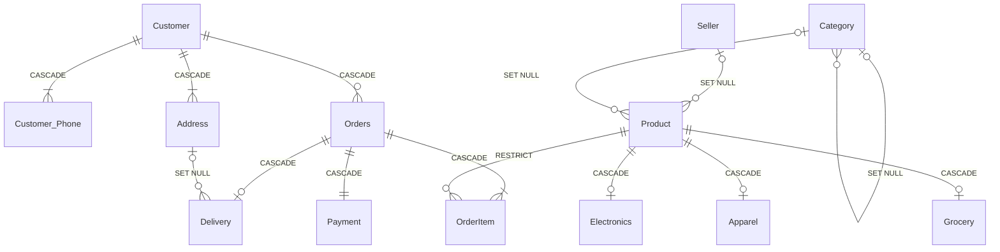

# Question 2: Relational Schema & MySQL Implementation for Indian E-Commerce Platform

**Problem Statement:**  
Convert the ER diagram into a relational schema. Write complete MySQL `CREATE TABLE` statements with primary keys, foreign keys, `NOT NULL`, `UNIQUE`, `ON DELETE CASCADE`, and `ON DELETE SET NULL` constraints. Insert sample data and demonstrate referential integrity violations.

## 1. Aim
To convert the Indian e-commerce EER diagram into a normalized relational database schema in MySQL, enforce entity and referential integrity using `PRIMARY KEY`, `FOREIGN KEY`, `NOT NULL`, `UNIQUE`, `ON DELETE CASCADE`, and `ON DELETE SET NULL` constraints, populate sample Indian e-commerce records, and demonstrate referential integrity violation errors.

## 2. Objectives
1. Map strong entities, weak entities (`Address`, `OrderItem`), multi-valued attributes (`Customer_Phone`), and `Product` specialization subclasses into normalized relational tables.
2. Implement MySQL DDL (`CREATE TABLE`) statements with `ON DELETE CASCADE` (for weak entities, subclasses, and identifying relationships) and `ON DELETE SET NULL` (for optional/non-identifying foreign keys like `Category.Parent_Category_ID`, `Product.Seller_ID`, and `Product.Category_ID`).
3. Insert valid sample data and execute test queries that trigger referential integrity violations (`ERROR 1451` and `ERROR 1452`).

## 3. Relational Schema Diagram



### Relational Schema Mapping (Brief)
1. **`Customer`** (`Customer_ID` [PK], `First_Name`, `Last_Name`, `Email` [UNIQUE, NOT NULL], `Reg_Date`)
2. **`Customer_Phone`** (`Customer_ID` [PK, FK $\rightarrow$ Customer `ON DELETE CASCADE`], `Phone_No` [PK])
3. **`Address`** (`Customer_ID` [PK, FK $\rightarrow$ Customer `ON DELETE CASCADE`], `Address_Tag` [PK], `Street`, `City`, `State`, `PIN_Code` [NOT NULL])
4. **`Seller`** (`Seller_ID` [PK], `Business_Name` [NOT NULL], `GSTIN` [UNIQUE, NOT NULL], `City`, `PIN_Code`)
5. **`Category`** (`Category_ID` [PK], `Category_Name` [UNIQUE, NOT NULL], `GST_Slab`, `Parent_Category_ID` [FK $\rightarrow$ Category `ON DELETE SET NULL`])
6. **`Product`** (`Product_ID` [PK], `Seller_ID` [FK $\rightarrow$ Seller `ON DELETE SET NULL`], `Category_ID` [FK $\rightarrow$ Category `ON DELETE SET NULL`], `Title` [NOT NULL], `HSN_Code` [NOT NULL], `MRP`, `Stock_Qty`, `Product_Type`)
7. **`Electronics`** (`Product_ID` [PK, FK $\rightarrow$ Product `ON DELETE CASCADE`], `Brand`, `Warranty_Months`, `BIS_No` [UNIQUE])
8. **`Apparel`** (`Product_ID` [PK, FK $\rightarrow$ Product `ON DELETE CASCADE`], `Size`, `Color`, `Fabric_Type`)
9. **`Grocery`** (`Product_ID` [PK, FK $\rightarrow$ Product `ON DELETE CASCADE`], `Expiry_Date`, `FSSAI_No`)
10. **`Orders`** (`Order_ID` [PK], `Customer_ID` [FK $\rightarrow$ Customer `ON DELETE CASCADE`, NOT NULL], `Order_Date`, `Order_Status`, `Total_Amount`)
11. **`OrderItem`** (`Order_ID` [PK, FK $\rightarrow$ Orders `ON DELETE CASCADE`], `Item_Seq_No` [PK], `Product_ID` [FK $\rightarrow$ Product `ON DELETE RESTRICT`, NOT NULL], `Quantity`, `Unit_Price`)
12. **`Payment`** (`Payment_ID` [PK], `Order_ID` [FK $\rightarrow$ Orders `ON DELETE CASCADE`, UNIQUE, NOT NULL], `Payment_Mode`, `UTR_Ref` [UNIQUE], `Amount_Paid`, `Payment_Status`)
13. **`Delivery`** (`Delivery_ID` [PK], `Order_ID` [FK $\rightarrow$ Orders `ON DELETE CASCADE`, UNIQUE, NOT NULL], `Customer_ID` [FK], `Address_Tag` [FK $\rightarrow$ Address `ON DELETE SET NULL`], `Courier_Partner`, `AWB_No` [UNIQUE], `Delivery_Status`)

## 4. Input (MySQL DDL, Sample Data & Integrity Tests)

```sql
CREATE DATABASE IF NOT EXISTS Indian_ECommerce;
USE Indian_ECommerce;

-- 1. Customer (Strong Entity)
CREATE TABLE Customer (
    Customer_ID INT PRIMARY KEY,
    First_Name VARCHAR(50) NOT NULL,
    Last_Name VARCHAR(50) NOT NULL,
    Email VARCHAR(100) NOT NULL UNIQUE,
    Reg_Date DATE NOT NULL
);

-- 2. Customer_Phone (Multi-Valued Attribute Table)
CREATE TABLE Customer_Phone (
    Customer_ID INT NOT NULL,
    Phone_No CHAR(10) NOT NULL UNIQUE,
    PRIMARY KEY (Customer_ID, Phone_No),
    CONSTRAINT fk_phone_cust FOREIGN KEY (Customer_ID)
        REFERENCES Customer(Customer_ID) ON DELETE CASCADE
);

-- 3. Address (Weak Entity dependent on Customer)
CREATE TABLE Address (
    Customer_ID INT NOT NULL,
    Address_Tag VARCHAR(20) NOT NULL,
    Street VARCHAR(150) NOT NULL,
    City VARCHAR(50) NOT NULL,
    State VARCHAR(50) NOT NULL,
    PIN_Code CHAR(6) NOT NULL,
    PRIMARY KEY (Customer_ID, Address_Tag),
    CONSTRAINT fk_addr_cust FOREIGN KEY (Customer_ID)
        REFERENCES Customer(Customer_ID) ON DELETE CASCADE
);

-- 4. Seller (Strong Entity)
CREATE TABLE Seller (
    Seller_ID INT PRIMARY KEY,
    Business_Name VARCHAR(100) NOT NULL,
    GSTIN CHAR(15) NOT NULL UNIQUE,
    City VARCHAR(50) NOT NULL,
    PIN_Code CHAR(6) NOT NULL
);

-- 5. Category (Self-Referencing Hierarchy with ON DELETE SET NULL)
CREATE TABLE Category (
    Category_ID INT PRIMARY KEY,
    Category_Name VARCHAR(80) NOT NULL UNIQUE,
    GST_Slab DECIMAL(5,2) NOT NULL,
    Parent_Category_ID INT NULL,
    CONSTRAINT fk_cat_parent FOREIGN KEY (Parent_Category_ID)
        REFERENCES Category(Category_ID) ON DELETE SET NULL
);

-- 6. Product (Superclass with ON DELETE SET NULL for Seller and Category)
CREATE TABLE Product (
    Product_ID INT PRIMARY KEY,
    Seller_ID INT NULL,
    Category_ID INT NULL,
    Title VARCHAR(120) NOT NULL,
    HSN_Code VARCHAR(10) NOT NULL,
    MRP DECIMAL(10,2) NOT NULL,
    Stock_Qty INT NOT NULL DEFAULT 0,
    Product_Type ENUM('ELECTRONICS', 'APPAREL', 'GROCERY') NOT NULL,
    CONSTRAINT fk_prod_seller FOREIGN KEY (Seller_ID)
        REFERENCES Seller(Seller_ID) ON DELETE SET NULL,
    CONSTRAINT fk_prod_cat FOREIGN KEY (Category_ID)
        REFERENCES Category(Category_ID) ON DELETE SET NULL
);

-- 7. Product Specialization Subclasses (ON DELETE CASCADE)
CREATE TABLE Electronics (
    Product_ID INT PRIMARY KEY,
    Brand VARCHAR(50) NOT NULL,
    Warranty_Months INT NOT NULL,
    BIS_No VARCHAR(30) NOT NULL UNIQUE,
    CONSTRAINT fk_elec_prod FOREIGN KEY (Product_ID)
        REFERENCES Product(Product_ID) ON DELETE CASCADE
);

CREATE TABLE Apparel (
    Product_ID INT PRIMARY KEY,
    Size VARCHAR(10) NOT NULL,
    Color VARCHAR(30) NOT NULL,
    Fabric_Type VARCHAR(50) NOT NULL,
    CONSTRAINT fk_appr_prod FOREIGN KEY (Product_ID)
        REFERENCES Product(Product_ID) ON DELETE CASCADE
);

CREATE TABLE Grocery (
    Product_ID INT PRIMARY KEY,
    Expiry_Date DATE NOT NULL,
    FSSAI_No CHAR(14) NOT NULL,
    CONSTRAINT fk_groc_prod FOREIGN KEY (Product_ID)
        REFERENCES Product(Product_ID) ON DELETE CASCADE
);

-- 8. Orders (Strong Entity)
CREATE TABLE Orders (
    Order_ID INT PRIMARY KEY,
    Customer_ID INT NOT NULL,
    Order_Date DATETIME NOT NULL DEFAULT CURRENT_TIMESTAMP,
    Order_Status VARCHAR(30) NOT NULL,
    Total_Amount DECIMAL(10,2) NOT NULL,
    CONSTRAINT fk_ord_cust FOREIGN KEY (Customer_ID)
        REFERENCES Customer(Customer_ID) ON DELETE CASCADE
);

-- 9. OrderItem (Weak Entity dependent on Orders; RESTRICT on Product deletion)
CREATE TABLE OrderItem (
    Order_ID INT NOT NULL,
    Item_Seq_No INT NOT NULL,
    Product_ID INT NOT NULL,
    Quantity INT NOT NULL,
    Unit_Price DECIMAL(10,2) NOT NULL,
    PRIMARY KEY (Order_ID, Item_Seq_No),
    CONSTRAINT fk_item_order FOREIGN KEY (Order_ID)
        REFERENCES Orders(Order_ID) ON DELETE CASCADE,
    CONSTRAINT fk_item_prod FOREIGN KEY (Product_ID)
        REFERENCES Product(Product_ID) ON DELETE RESTRICT
);

-- 10. Payment (1:1 with Orders, ON DELETE CASCADE)
CREATE TABLE Payment (
    Payment_ID INT PRIMARY KEY,
    Order_ID INT NOT NULL UNIQUE,
    Payment_Mode ENUM('UPI', 'CARD', 'NETBANKING', 'COD') NOT NULL,
    UTR_Ref VARCHAR(40) UNIQUE,
    Amount_Paid DECIMAL(10,2) NOT NULL,
    Payment_Status VARCHAR(20) NOT NULL,
    CONSTRAINT fk_pay_order FOREIGN KEY (Order_ID)
        REFERENCES Orders(Order_ID) ON DELETE CASCADE
);

-- 11. Delivery (1:1 with Orders, ON DELETE SET NULL on Address)
CREATE TABLE Delivery (
    Delivery_ID INT PRIMARY KEY,
    Order_ID INT NOT NULL UNIQUE,
    Customer_ID INT NULL,
    Address_Tag VARCHAR(20) NULL,
    Courier_Partner VARCHAR(50) NOT NULL,
    AWB_No VARCHAR(30) NOT NULL UNIQUE,
    Delivery_Status VARCHAR(30) NOT NULL,
    CONSTRAINT fk_del_order FOREIGN KEY (Order_ID)
        REFERENCES Orders(Order_ID) ON DELETE CASCADE,
    CONSTRAINT fk_del_addr FOREIGN KEY (Customer_ID, Address_Tag)
        REFERENCES Address(Customer_ID, Address_Tag) ON DELETE SET NULL
);

-- ==========================================
-- INSERT SAMPLE DATA
-- ==========================================
INSERT INTO Customer VALUES
(101, 'Aarav', 'Sharma', 'aarav.sharma@email.in', '2025-01-15'),
(102, 'Priya', 'Nair', 'priya.nair@email.in', '2025-06-20');

INSERT INTO Customer_Phone VALUES
(101, '9876543210'),
(101, '9123456780');

INSERT INTO Address VALUES
(101, 'HOME', 'Flat 402, Gomti Nagar', 'Lucknow', 'Uttar Pradesh', '226010'),
(102, 'WORK', 'Plot 12, Indiranagar', 'Bengaluru', 'Karnataka', '560038');

INSERT INTO Seller VALUES
(201, 'Bharat Tech Retail Pvt Ltd', '27AABCU9603R1ZM', 'Mumbai', '400001'),
(202, 'Desi Looms India', '09AAACD1289D1Z5', 'Varanasi', '221001');

INSERT INTO Category VALUES
(1, 'Electronics', 18.00, NULL),
(2, 'Audio Devices', 18.00, 1),
(3, 'Ethnic Wear', 12.00, NULL);

INSERT INTO Product VALUES
(301, 201, 2, 'BoAt Nirvana ANC Earbuds', '85183000', 1999.00, 50, 'ELECTRONICS'),
(302, 202, 3, 'Banarasi Cotton Kurta', '62052000', 1499.00, 30, 'APPAREL');

INSERT INTO Electronics VALUES (301, 'BoAt', 12, 'BIS-R-41123456');
INSERT INTO Apparel VALUES (302, 'L', 'Indigo', '100% Cotton');

INSERT INTO Orders VALUES (5001, 101, '2026-10-25 14:30:00', 'Confirmed', 3498.00);
INSERT INTO OrderItem VALUES (5001, 1, 301, 1, 1999.00), (5001, 2, 302, 1, 1499.00);
INSERT INTO Payment VALUES (7001, 5001, 'UPI', 'UTR630019283741', 3498.00, 'Success');
INSERT INTO Delivery VALUES (8001, 5001, 101, 'HOME', 'Delhivery', 'AWB99887766', 'In Transit');

-- ==========================================
-- REFERENTIAL INTEGRITY VIOLATION TESTS
-- ==========================================

-- Violation 1: Insert Order for non-existent Customer_ID (999)
INSERT INTO Orders VALUES (5002, 999, NOW(), 'Pending', 999.00);

-- Violation 2: Insert OrderItem referencing non-existent Product_ID (999)
INSERT INTO OrderItem VALUES (5001, 3, 999, 1, 500.00);

-- Violation 3: Delete Product (301) that is referenced in OrderItem (ON DELETE RESTRICT)
DELETE FROM Product WHERE Product_ID = 301;

-- Valid Action 4: Demonstrate ON DELETE SET NULL (Deleting Seller 202 sets Seller_ID = NULL in Product 302)
DELETE FROM Seller WHERE Seller_ID = 202;

-- Valid Action 5: Demonstrate ON DELETE CASCADE (Deleting Order 5001 cascades to OrderItem, Payment, Delivery)
DELETE FROM Orders WHERE Order_ID = 5001;
```

## 5. Output

### 5.1 Initial Joined Order Summary Output (Before Deletions)

| Order_ID | Customer | City (`PIN_Code`) | Item_Seq | Product_Title | Seller_GSTIN | Payment_Mode (`UTR_Ref`) | Courier (`AWB_No`) |
| :--- | :--- | :--- | ---: | :--- | :--- | :--- | :--- |
| `5001` | Aarav Sharma | Lucknow (`226010`) | 1 | BoAt Nirvana ANC Earbuds | `27AABCU9603R1ZM` | `UPI` (`UTR630019283741`) | Delhivery (`AWB99887766`) |
| `5001` | Aarav Sharma | Lucknow (`226010`) | 2 | Banarasi Cotton Kurta | `09AAACD1289D1Z5` | `UPI` (`UTR630019283741`) | Delhivery (`AWB99887766`) |

### 5.2 Referential Integrity Violation & Constraint Execution Output

| Test Case | SQL Statement Executed | MySQL Engine Result / Error Code | Integrity Mechanism Demonstrated |
| :--- | :--- | :--- | :--- |
| **Violation 1 (Orphan Child Insert)** | `INSERT INTO Orders VALUES (5002, 999, ...);` | `ERROR 1452 (23000): Cannot add or update a child row: a foreign key constraint fails (fk_ord_cust)` | Rejects `Orders` row because parent `Customer_ID = 999` does not exist in `Customer`. |
| **Violation 2 (Invalid Product FK)** | `INSERT INTO OrderItem VALUES (5001, 3, 999, ...);` | `ERROR 1452 (23000): Cannot add or update a child row: a foreign key constraint fails (fk_item_prod)` | Rejects line item referencing non-existent `Product_ID = 999`. |
| **Violation 3 (Restricted Parent Delete)** | `DELETE FROM Product WHERE Product_ID = 301;` | `ERROR 1451 (23000): Cannot delete or update a parent row: a foreign key constraint fails (fk_item_prod)` | `ON DELETE RESTRICT` prevents deleting a catalog product that has active `OrderItem` records. |
| **Action 4 (`ON DELETE SET NULL`)** | `DELETE FROM Seller WHERE Seller_ID = 202;` | `Query OK, 1 row affected` $\rightarrow$ `Product(302).Seller_ID` becomes `NULL` | `ON DELETE SET NULL` retains the product in catalog while setting its `Seller_ID` to `NULL`. |
| **Action 5 (`ON DELETE CASCADE`)** | `DELETE FROM Orders WHERE Order_ID = 5001;` | `Query OK, 1 row affected` $\rightarrow$ Auto-deletes rows in `OrderItem`, `Payment`, and `Delivery` | `ON DELETE CASCADE` removes all dependent weak entity and 1:1 records tied to `Order_ID = 5001`. |
