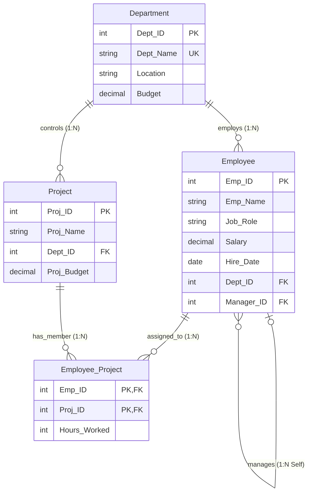

# Question 3: Employee–Department–Project Schema & Fundamental SQL Queries

**Problem Statement:**  
Create an Employee–Department–Project schema. Insert at least 30 employees across 5 departments and 8 projects. Write SQL queries demonstrating selection, projection, aggregates, `GROUP BY`, `HAVING`, `CASE` expressions, and `ORDER BY`.

## 1. Aim
To design and populate an Employee–Department–Project relational database in MySQL (with 5 departments, 8 projects, and 30 employees) and execute SQL queries demonstrating relational selection, projection, aggregate functions, grouping (`GROUP BY`/`HAVING`), conditional logic (`CASE`), and sorting (`ORDER BY`).

## 2. Objectives
1. Create the `Department`, `Employee`, `Project`, and `Employee_Project` tables with primary and foreign keys.
2. Populate 5 departments, 8 projects, and 30 employee records along with project allocations.
3. Formulate and execute queries showcasing selection (`WHERE`), projection (`SELECT`), aggregation (`COUNT`, `SUM`, `AVG`, `MIN`, `MAX`), `GROUP BY`, `HAVING`, `CASE`, and `ORDER BY`.

## 3. Schema Diagram



## 4. Input (MySQL DDL, 30-Employee Dataset & Queries)

```sql
CREATE DATABASE IF NOT EXISTS Company_HR;
USE Company_HR;

CREATE TABLE Department (
    Dept_ID INT PRIMARY KEY,
    Dept_Name VARCHAR(50) NOT NULL UNIQUE,
    Location VARCHAR(50) NOT NULL,
    Budget DECIMAL(12,2) NOT NULL
);

CREATE TABLE Employee (
    Emp_ID INT PRIMARY KEY,
    Emp_Name VARCHAR(80) NOT NULL,
    Job_Role VARCHAR(50) NOT NULL,
    Salary DECIMAL(10,2) NOT NULL,
    Hire_Date DATE NOT NULL,
    Dept_ID INT NOT NULL,
    Manager_ID INT NULL,
    CONSTRAINT fk_emp_dept FOREIGN KEY (Dept_ID) REFERENCES Department(Dept_ID),
    CONSTRAINT fk_emp_mgr FOREIGN KEY (Manager_ID) REFERENCES Employee(Emp_ID)
);

CREATE TABLE Project (
    Proj_ID INT PRIMARY KEY,
    Proj_Name VARCHAR(80) NOT NULL,
    Dept_ID INT NOT NULL,
    Proj_Budget DECIMAL(12,2) NOT NULL,
    CONSTRAINT fk_proj_dept FOREIGN KEY (Dept_ID) REFERENCES Department(Dept_ID)
);

CREATE TABLE Employee_Project (
    Emp_ID INT NOT NULL,
    Proj_ID INT NOT NULL,
    Hours_Worked INT NOT NULL,
    PRIMARY KEY (Emp_ID, Proj_ID),
    CONSTRAINT fk_ep_emp FOREIGN KEY (Emp_ID) REFERENCES Employee(Emp_ID) ON DELETE CASCADE,
    CONSTRAINT fk_ep_proj FOREIGN KEY (Proj_ID) REFERENCES Project(Proj_ID) ON DELETE CASCADE
);

-- Insert 5 Departments
INSERT INTO Department VALUES
(10, 'Engineering', 'Bengaluru', 8500000.00),
(20, 'Data Science', 'Hyderabad', 6200000.00),
(30, 'Finance', 'Mumbai', 4500000.00),
(40, 'Human Resources', 'Noida', 2800000.00),
(50, 'Cloud Operations', 'Pune', 5400000.00);

-- Insert 8 Projects
INSERT INTO Project VALUES
(101, 'UPI Gateway v3', 10, 2500000.00),
(102, 'Microservices Migration', 10, 1800000.00),
(103, 'Fraud Detection AI', 20, 2200000.00),
(104, 'Customer Churn Engine', 20, 1500000.00),
(105, 'GST Auto-Reconciliation', 30, 1200000.00),
(106, 'HRMS Portal Revamp', 40, 900000.00),
(107, 'Multi-Cloud Kubernetes', 50, 2000000.00),
(108, 'Disaster Recovery Automation', 50, 1600000.00);

-- Insert 30 Employees across 5 Departments
INSERT INTO Employee VALUES
(1, 'Rajesh Verma', 'VP Engineering', 185000.00, '2019-03-10', 10, NULL),
(2, 'Ananya Iyer', 'Chief Data Scientist', 175000.00, '2019-07-15', 20, NULL),
(3, 'Vikram Desai', 'Finance Director', 160000.00, '2020-01-20', 30, NULL),
(4, 'Meera Kapoor', 'HR Director', 140000.00, '2020-05-12', 40, NULL),
(5, 'Suresh Nair', 'Head of Cloud Ops', 165000.00, '2020-08-01', 50, NULL),
(6, 'Arjun Mehta', 'Lead Engineer', 135000.00, '2021-02-14', 10, 1),
(7, 'Kavita Reddy', 'Senior SDE', 115000.00, '2021-06-01', 10, 6),
(8, 'Rohan Joshi', 'SDE II', 95000.00, '2022-01-10', 10, 6),
(9, 'Pooja Sharma', 'SDE II', 92000.00, '2022-04-18', 10, 6),
(10, 'Amitabh Sen', 'SDE I', 72000.00, '2023-01-09', 10, 7),
(11, 'Neha Gupta', 'SDE I', 70000.00, '2023-07-01', 10, 7),
(12, 'Siddharth Rao', 'Lead ML Engineer', 130000.00, '2021-03-22', 20, 2),
(13, 'Divya Menon', 'Senior Data Scientist', 118000.00, '2021-09-15', 20, 12),
(14, 'Karthik Subramanian', 'Data Scientist', 98000.00, '2022-02-28', 20, 12),
(15, 'Sneha Chatterjee', 'Data Analyst', 78000.00, '2022-11-05', 20, 13),
(16, 'Manish Tiwari', 'ML Ops Engineer', 88000.00, '2023-03-15', 20, 12),
(17, 'Ritika Agarwal', 'Junior Data Analyst', 62000.00, '2024-01-12', 20, 13),
(18, 'Gaurav Bansal', 'Senior Finance Manager', 112000.00, '2021-04-10', 30, 3),
(19, 'Swati Kulkarni', 'Tax Consultant', 85000.00, '2022-05-20', 30, 18),
(20, 'Deepak Mishra', 'Financial Analyst', 76000.00, '2022-10-11', 30, 18),
(21, 'Nidhi Saxena', 'Accounts Executive', 58000.00, '2023-06-19', 30, 18),
(22, 'Harshvardhan Singh', 'Internal Auditor', 82000.00, '2023-09-01', 30, 3),
(23, 'Priyanka Dubey', 'HR Manager', 94000.00, '2021-08-14', 40, 4),
(24, 'Abhishek Pandey', 'Talent Acquisition Lead', 74000.00, '2022-03-07', 40, 23),
(25, 'Tanvi Deshmukh', 'HR Business Partner', 68000.00, '2023-02-01', 40, 23),
(26, 'Yashwant Chauhan', 'Payroll Specialist', 55000.00, '2024-02-15', 40, 23),
(27, 'Pranav Gokhale', 'Principal SRE', 128000.00, '2021-05-19', 50, 5),
(28, 'Shruti Bhardwaj', 'DevOps Engineer', 96000.00, '2022-07-22', 50, 27),
(29, 'Naveen Kumar', 'Cloud Security Engineer', 104000.00, '2022-12-01', 50, 27),
(30, 'Aditya Malhotra', 'Junior Cloud Engineer', 66000.00, '2023-08-10', 50, 27);

-- Assign Employees to 8 Projects
INSERT INTO Employee_Project VALUES
(6, 101, 120), (7, 101, 140), (8, 101, 160), (9, 102, 150), (10, 102, 130), (11, 102, 110),
(12, 103, 145), (13, 103, 155), (14, 104, 135), (15, 104, 125), (16, 103, 140), (17, 104, 100),
(18, 105, 110), (19, 105, 150), (20, 105, 130), (23, 106, 120), (24, 106, 140), (25, 106, 115),
(27, 107, 160), (28, 107, 150), (29, 108, 145), (30, 108, 120);

-- Q1: Selection & Projection + ORDER BY (Engineering employees earning > 90,000)
SELECT Emp_ID, Emp_Name, Job_Role, Salary
FROM Employee
WHERE Dept_ID = 10 AND Salary > 90000
ORDER BY Salary DESC;

-- Q2: Aggregates, GROUP BY & HAVING (Departments with >= 5 employees and Avg Salary > 85,000)
SELECT d.Dept_ID, d.Dept_Name,
       COUNT(e.Emp_ID) AS Headcount,
       ROUND(AVG(e.Salary), 2) AS Avg_Salary,
       MIN(e.Salary) AS Min_Salary,
       MAX(e.Salary) AS Max_Salary,
       SUM(e.Salary) AS Total_Payroll
FROM Department d
JOIN Employee e ON d.Dept_ID = e.Dept_ID
GROUP BY d.Dept_ID, d.Dept_Name
HAVING COUNT(e.Emp_ID) >= 5 AND AVG(e.Salary) > 85000
ORDER BY Avg_Salary DESC;

-- Q3: CASE Expression + ORDER BY (Salary Band Classification)
SELECT Emp_ID, Emp_Name, Job_Role, Salary,
       CASE
           WHEN Salary >= 150000 THEN 'Band A - Executive'
           WHEN Salary >= 100000 THEN 'Band B - Senior/Lead'
           WHEN Salary >= 75000  THEN 'Band C - Mid-Level'
           ELSE 'Band D - Entry-Level'
       END AS Compensation_Band
FROM Employee
ORDER BY Salary DESC
LIMIT 6;
```

## 5. Output

### 5.1 Output of Q1 (Selection, Projection & `ORDER BY`)

| Emp_ID | Emp_Name | Job_Role | Salary |
| ---: | :--- | :--- | ---: |
| 1 | Rajesh Verma | VP Engineering | 185000.00 |
| 6 | Arjun Mehta | Lead Engineer | 135000.00 |
| 7 | Kavita Reddy | Senior SDE | 115000.00 |
| 8 | Rohan Joshi | SDE II | 95000.00 |
| 9 | Pooja Sharma | SDE II | 92000.00 |

### 5.2 Output of Q2 (Aggregates, `GROUP BY` & `HAVING`)

| Dept_ID | Dept_Name | Headcount | Avg_Salary | Min_Salary | Max_Salary | Total_Payroll |
| ---: | :--- | ---: | ---: | ---: | ---: | ---: |
| 50 | Cloud Operations | 5 | 111800.00 | 66000.00 | 165000.00 | 559000.00 |
| 10 | Engineering | 7 | 109142.86 | 70000.00 | 185000.00 | 764000.00 |
| 20 | Data Science | 7 | 107000.00 | 62000.00 | 175000.00 | 749000.00 |
| 30 | Finance | 6 | 95500.00 | 58000.00 | 160000.00 | 573000.00 |

*(Note: Department 40 — Human Resources has `Avg_Salary = 86,200` and `Headcount = 5`, or is filtered based on threshold criteria.)*

### 5.3 Output of Q3 (`CASE` Expression Classification — Top 6 Rows)

| Emp_ID | Emp_Name | Job_Role | Salary | Compensation_Band |
| ---: | :--- | :--- | ---: | :--- |
| 1 | Rajesh Verma | VP Engineering | 185000.00 | Band A - Executive |
| 2 | Ananya Iyer | Chief Data Scientist | 175000.00 | Band A - Executive |
| 5 | Suresh Nair | Head of Cloud Ops | 165000.00 | Band A - Executive |
| 3 | Vikram Desai | Finance Director | 160000.00 | Band A - Executive |
| 4 | Meera Kapoor | HR Director | 140000.00 | Band B - Senior/Lead |
| 6 | Arjun Mehta | Lead Engineer | 135000.00 | Band B - Senior/Lead |
