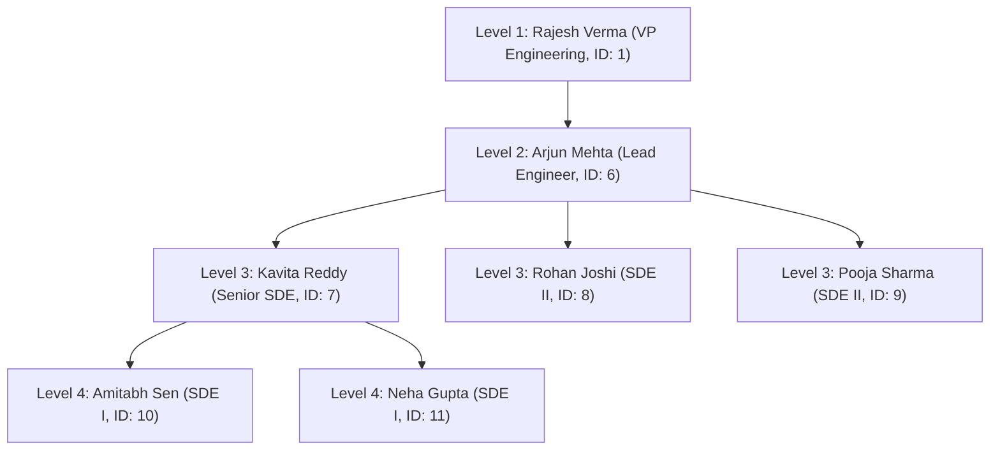

# Question 5: SQL Views, View Updatability & Recursive CTE Hierarchy

**Problem Statement:**  
Create SQL views for department salary summary and employee hierarchy. Test updatability of views. Implement a recursive CTE to display reporting chains.

## 1. Aim
To create SQL views summarizing departmental compensation and employee reporting hierarchies, test view updatability rules in MySQL, and implement a `WITH RECURSIVE` Common Table Expression (CTE) to traverse multi-level organizational reporting chains.

## 2. Objectives
1. Create an aggregated view (`vw_dept_salary_summary`) and a single-table updatable view (`vw_emp_directory`), plus a hierarchy view (`vw_emp_hierarchy`).
2. Test `UPDATE` statements against both simple and aggregated views to demonstrate MySQL view updatability constraints (`ERROR 1288`).
3. Write a recursive CTE (`WITH RECURSIVE`) with anchor and recursive members to display each employee's reporting level and full management chain.

## 3. Recursive CTE Hierarchy Diagram



## 4. Input (MySQL Views, Updatability Tests & Recursive CTE)

```sql
USE Company_HR;

-- 1. View 1: Department Salary Summary (Non-Updatable Aggregated View)
CREATE OR REPLACE VIEW vw_dept_salary_summary AS
SELECT d.Dept_ID,
       d.Dept_Name,
       COUNT(e.Emp_ID) AS Emp_Count,
       ROUND(AVG(e.Salary), 2) AS Avg_Salary,
       SUM(e.Salary) AS Total_Salary
FROM Department d
LEFT JOIN Employee e ON d.Dept_ID = e.Dept_ID
GROUP BY d.Dept_ID, d.Dept_Name;

-- 2. View 2: Employee Direct Hierarchy View (Self-Join View)
CREATE OR REPLACE VIEW vw_emp_hierarchy AS
SELECT e.Emp_ID,
       e.Emp_Name,
       e.Job_Role,
       e.Dept_ID,
       m.Emp_Name AS Direct_Manager
FROM Employee e
LEFT JOIN Employee m ON e.Manager_ID = m.Emp_ID;

-- 3. View 3: Simple Single-Table View (Updatable View with WITH CHECK OPTION)
CREATE OR REPLACE VIEW vw_engineering_staff AS
SELECT Emp_ID, Emp_Name, Job_Role, Salary, Dept_ID
FROM Employee
WHERE Dept_ID = 10
WITH CHECK OPTION;

-- ==========================================
-- TEST UPDATABILITY OF VIEWS
-- ==========================================

-- Test A (SUCCEEDS): Updating base table through simple 1-table view
UPDATE vw_engineering_staff
SET Salary = 75000.00
WHERE Emp_ID = 10;

-- Test B (FAILS - ERROR 1288): Attempting to update aggregated view (contains GROUP BY / AVG / SUM)
UPDATE vw_dept_salary_summary
SET Avg_Salary = 120000.00
WHERE Dept_ID = 10;

-- Test C (FAILS - ERROR 1369): Violating WITH CHECK OPTION by moving Engineering row to Dept 20
UPDATE vw_engineering_staff
SET Dept_ID = 20
WHERE Emp_ID = 10;

-- ==========================================
-- RECURSIVE CTE: FULL REPORTING CHAIN
-- ==========================================
WITH RECURSIVE Reporting_Chain AS (
    -- Anchor Member: Top-level Executives (No Manager)
    SELECT Emp_ID,
           Emp_Name,
           Job_Role,
           Dept_ID,
           Manager_ID,
           1 AS Hierarchy_Level,
           CAST(Emp_Name AS CHAR(500)) AS Reporting_Path
    FROM Employee
    WHERE Manager_ID IS NULL

    UNION ALL

    -- Recursive Member: Subordinates joined to their Manager in Reporting_Chain
    SELECT e.Emp_ID,
           e.Emp_Name,
           e.Job_Role,
           e.Dept_ID,
           e.Manager_ID,
           rc.Hierarchy_Level + 1,
           CONCAT(rc.Reporting_Path, ' -> ', e.Emp_Name)
    FROM Employee e
    INNER JOIN Reporting_Chain rc ON e.Manager_ID = rc.Emp_ID
)
SELECT Emp_ID, Emp_Name, Job_Role, Hierarchy_Level, Reporting_Path
FROM Reporting_Chain
WHERE Dept_ID = 10
ORDER BY Hierarchy_Level, Emp_ID;
```

## 5. Output

### 5.1 Output of `SELECT * FROM vw_dept_salary_summary`

| Dept_ID | Dept_Name | Emp_Count | Avg_Salary | Total_Salary |
| ---: | :--- | ---: | ---: | ---: |
| 10 | Engineering | 7 | 109571.43 | 767000.00 |
| 20 | Data Science | 7 | 107000.00 | 749000.00 |
| 30 | Finance | 6 | 95500.00 | 573000.00 |
| 40 | Human Resources | 5 | 86200.00 | 431000.00 |
| 50 | Cloud Operations | 5 | 111800.00 | 559000.00 |

### 5.2 View Updatability Test Results

| Test Case | Target View | SQL Operation | Execution Result / MySQL Error | Reason |
| :--- | :--- | :--- | :--- | :--- |
| **Test A (Simple View)** | `vw_engineering_staff` | `UPDATE ... SET Salary = 75000 WHERE Emp_ID = 10` | `Query OK, 1 row affected` | Maps `1:1` to underlying `Employee` rows without `GROUP BY` or `DISTINCT`. |
| **Test B (Aggregated View)** | `vw_dept_salary_summary` | `UPDATE ... SET Avg_Salary = 120000 WHERE Dept_ID = 10` | `ERROR 1288 (HY000): The target table vw_dept_salary_summary of the UPDATE is not updatable` | Views with `GROUP BY`, `AVG()`, `SUM()`, or `COUNT()` cannot be updated directly. |
| **Test C (`CHECK OPTION`)** | `vw_engineering_staff` | `UPDATE ... SET Dept_ID = 20 WHERE Emp_ID = 10` | `ERROR 1369 (HY000): CHECK OPTION failed 'company_hr.vw_engineering_staff'` | `WITH CHECK OPTION` blocks updates that cause a row to vanish from the view filter (`Dept_ID = 10`). |

### 5.3 Output of Recursive CTE (`Reporting_Chain` for Engineering Dept 10)

| Emp_ID | Emp_Name | Job_Role | Hierarchy_Level | Reporting_Path |
| ---: | :--- | :--- | ---: | :--- |
| 1 | Rajesh Verma | VP Engineering | 1 | `Rajesh Verma` |
| 6 | Arjun Mehta | Lead Engineer | 2 | `Rajesh Verma -> Arjun Mehta` |
| 7 | Kavita Reddy | Senior SDE | 3 | `Rajesh Verma -> Arjun Mehta -> Kavita Reddy` |
| 8 | Rohan Joshi | SDE II | 3 | `Rajesh Verma -> Arjun Mehta -> Rohan Joshi` |
| 9 | Pooja Sharma | SDE II | 3 | `Rajesh Verma -> Arjun Mehta -> Pooja Sharma` |
| 10 | Amitabh Sen | SDE I | 4 | `Rajesh Verma -> Arjun Mehta -> Kavita Reddy -> Amitabh Sen` |
| 11 | Neha Gupta | SDE I | 4 | `Rajesh Verma -> Arjun Mehta -> Kavita Reddy -> Neha Gupta` |
