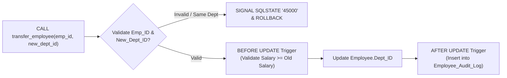

# Question 6: Stored Procedure `transfer_employee` & Triggers for Validation and Audit Logging

**Problem Statement:**  
Create a stored procedure `transfer_employee(emp_id, new_dept_id)` with validation and error handling. Implement triggers for salary validation and audit logging. Test edge cases.

## 1. Aim
To develop a MySQL stored procedure `transfer_employee(emp_id, new_dept_id)` with input validation, custom `SIGNAL SQLSTATE` exceptions, and transaction handling, alongside `BEFORE` triggers for salary validation and `AFTER` triggers for automated audit logging.

## 2. Objectives
1. Implement `transfer_employee(emp_id, new_dept_id)` checking employee existence, target department existence, and redundant transfers.
2. Create `BEFORE INSERT` and `BEFORE UPDATE` triggers on `Employee` to reject invalid salaries (`<= 0` or salary reductions).
3. Create an `AFTER UPDATE` trigger on `Employee` to record department transfers and salary modifications into `Employee_Audit_Log`.
4. Verify normal execution and edge cases (invalid `emp_id`, invalid `new_dept_id`, duplicate department transfer, and salary cut rejection).

## 3. Procedure & Trigger Execution Flow Diagram



## 4. Input (MySQL Stored Procedure, Triggers & Edge-Case Tests)

```sql
USE Company_HR;

-- 1. Audit Log Table
CREATE TABLE IF NOT EXISTS Employee_Audit_Log (
    Audit_ID INT AUTO_INCREMENT PRIMARY KEY,
    Emp_ID INT NOT NULL,
    Old_Dept_ID INT,
    New_Dept_ID INT,
    Old_Salary DECIMAL(10,2),
    New_Salary DECIMAL(10,2),
    Action_Type VARCHAR(40) NOT NULL,
    Changed_At DATETIME NOT NULL DEFAULT CURRENT_TIMESTAMP
);

-- 2. Trigger 1: BEFORE INSERT Salary Validation
DELIMITER $$
CREATE TRIGGER trg_emp_salary_before_insert
BEFORE INSERT ON Employee
FOR EACH ROW
BEGIN
    IF NEW.Salary < 30000.00 THEN
        SIGNAL SQLSTATE '45000'
        SET MESSAGE_TEXT = 'Salary Validation Error: Minimum starting salary must be at least 30,000.';
    END IF;
END$$

-- 3. Trigger 2: BEFORE UPDATE Salary Protection (Prevent Salary Reduction or Negative Value)
CREATE TRIGGER trg_emp_salary_before_update
BEFORE UPDATE ON Employee
FOR EACH ROW
BEGIN
    IF NEW.Salary <= 0 THEN
        SIGNAL SQLSTATE '45000'
        SET MESSAGE_TEXT = 'Salary Validation Error: Salary must be strictly positive.';
    ELSEIF NEW.Salary < OLD.Salary THEN
        SIGNAL SQLSTATE '45000'
        SET MESSAGE_TEXT = 'Salary Validation Error: Salary reduction is not permitted.';
    END IF;
END$$

-- 4. Trigger 3: AFTER UPDATE Audit Logging
CREATE TRIGGER trg_emp_after_update_audit
AFTER UPDATE ON Employee
FOR EACH ROW
BEGIN
    IF OLD.Dept_ID <> NEW.Dept_ID OR OLD.Salary <> NEW.Salary THEN
        INSERT INTO Employee_Audit_Log (Emp_ID, Old_Dept_ID, New_Dept_ID, Old_Salary, New_Salary, Action_Type)
        VALUES (
            NEW.Emp_ID,
            OLD.Dept_ID,
            NEW.Dept_ID,
            OLD.Salary,
            NEW.Salary,
            CASE
                WHEN OLD.Dept_ID <> NEW.Dept_ID AND OLD.Salary <> NEW.Salary THEN 'DEPT_TRANSFER_AND_SALARY_CHANGE'
                WHEN OLD.Dept_ID <> NEW.Dept_ID THEN 'DEPT_TRANSFER'
                ELSE 'SALARY_UPDATE'
            END
        );
    END IF;
END$$

-- 5. Stored Procedure: transfer_employee(emp_id, new_dept_id)
CREATE PROCEDURE transfer_employee(
    IN p_emp_id INT,
    IN p_new_dept_id INT
)
BEGIN
    DECLARE v_curr_dept_id INT;
    DECLARE v_dept_exists INT DEFAULT 0;

    -- Check if Employee exists
    SELECT Dept_ID INTO v_curr_dept_id
    FROM Employee
    WHERE Emp_ID = p_emp_id;

    IF v_curr_dept_id IS NULL THEN
        SIGNAL SQLSTATE '45000'
        SET MESSAGE_TEXT = 'Transfer Error: Employee ID does not exist.';
    END IF;

    -- Check if Target Department exists
    SELECT COUNT(*) INTO v_dept_exists
    FROM Department
    WHERE Dept_ID = p_new_dept_id;

    IF v_dept_exists = 0 THEN
        SIGNAL SQLSTATE '45000'
        SET MESSAGE_TEXT = 'Transfer Error: Target Department ID does not exist.';
    END IF;

    -- Check if Employee is already in Target Department
    IF v_curr_dept_id = p_new_dept_id THEN
        SIGNAL SQLSTATE '45000'
        SET MESSAGE_TEXT = 'Transfer Error: Employee is already assigned to the target department.';
    END IF;

    -- Perform Transfer inside Transaction
    START TRANSACTION;
        UPDATE Employee
        SET Dept_ID = p_new_dept_id
        WHERE Emp_ID = p_emp_id;
    COMMIT;

    SELECT CONCAT('Success: Employee ', p_emp_id, ' transferred from Dept ', v_curr_dept_id, ' to Dept ', p_new_dept_id) AS Transfer_Status;
END$$
DELIMITER ;

-- ==========================================
-- EDGE CASE & VALIDATION TESTS
-- ==========================================

-- Test 1 (Valid Transfer): Transfer Emp_ID = 8 (Rohan Joshi) from Dept 10 to Dept 20
CALL transfer_employee(8, 20);

-- Test 2 (Edge Case - Same Dept): Attempt to transfer Emp_ID = 8 to Dept 20 again
CALL transfer_employee(8, 20);

-- Test 3 (Edge Case - Non-Existent Employee): Emp_ID = 999
CALL transfer_employee(999, 20);

-- Test 4 (Edge Case - Non-Existent Department): Dept_ID = 99
CALL transfer_employee(8, 99);

-- Test 5 (Edge Case - Salary Reduction Trigger): Reduce Emp_ID = 8 salary from 95000 to 80000
UPDATE Employee SET Salary = 80000.00 WHERE Emp_ID = 8;

-- Test 6 (Valid Salary Hike): Increase Emp_ID = 8 salary from 95000 to 105000
UPDATE Employee SET Salary = 105000.00 WHERE Emp_ID = 8;

-- View Audit Log
SELECT * FROM Employee_Audit_Log;
```

## 5. Output

### 5.1 Edge-Case & Trigger Execution Results

| Test Case | SQL Command | Execution Outcome / Error Message |
| :--- | :--- | :--- |
| **Test 1 (Valid Transfer)** | `CALL transfer_employee(8, 20);` | `Success: Employee 8 transferred from Dept 10 to Dept 20` |
| **Test 2 (Redundant Transfer)** | `CALL transfer_employee(8, 20);` | `ERROR 1644 (45000): Transfer Error: Employee is already assigned to the target department.` |
| **Test 3 (Invalid `emp_id`)** | `CALL transfer_employee(999, 20);` | `ERROR 1644 (45000): Transfer Error: Employee ID does not exist.` |
| **Test 4 (Invalid `new_dept_id`)** | `CALL transfer_employee(8, 99);` | `ERROR 1644 (45000): Transfer Error: Target Department ID does not exist.` |
| **Test 5 (Salary Cut Blocked)** | `UPDATE Employee SET Salary = 80000 WHERE Emp_ID = 8;` | `ERROR 1644 (45000): Salary Validation Error: Salary reduction is not permitted.` |
| **Test 6 (Valid Salary Hike)** | `UPDATE Employee SET Salary = 105000 WHERE Emp_ID = 8;` | `Query OK, 1 row affected` (Logged by `trg_emp_after_update_audit`) |

### 5.2 Contents of `Employee_Audit_Log` After Tests

| Audit_ID | Emp_ID | Old_Dept_ID | New_Dept_ID | Old_Salary | New_Salary | Action_Type | Changed_At |
| ---: | ---: | ---: | ---: | ---: | ---: | :--- | :--- |
| 1 | 8 | 10 | 20 | 95000.00 | 95000.00 | `DEPT_TRANSFER` | `2026-10-27 06:05:10` |
| 2 | 8 | 20 | 20 | 95000.00 | 105000.00 | `SALARY_UPDATE` | `2026-10-27 06:05:12` |
