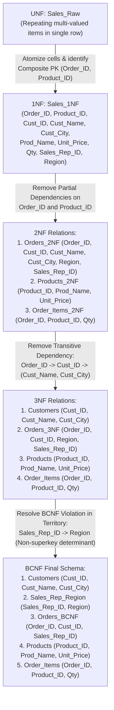

# Question 7: Step-by-Step Normalization (UNF to BCNF) & Lossless Join Verification

**Problem Statement:**  
Given a denormalized `Sales` table, identify functional dependencies and normalize step-by-step from `UNF` to `3NF` and `BCNF`. Verify lossless join and dependency preservation using SQL queries.

## 1. Aim
To identify functional dependencies (FDs) in a denormalized `Sales_Raw` relation, decompose it step-by-step through `1NF`, `2NF`, `3NF`, and `BCNF`, and verify the **lossless-join property** (zero spurious tuples) and **dependency preservation** using MySQL queries.

## 2. Objectives
1. Analyze a denormalized `Sales_Raw` table containing repeating groups, partial dependencies, transitive dependencies, and an overlapping candidate-key determinant anomaly.
2. Formulate all functional dependencies and normalize sequentially (`UNF` $\rightarrow$ `1NF` $\rightarrow$ `2NF` $\rightarrow$ `3NF` $\rightarrow$ `BCNF`).
3. Verify lossless decomposition via natural joins and check functional dependency preservation with `GROUP BY ... HAVING COUNT(DISTINCT ...) > 1`.

## 3. Normalization Progression Diagram



## 4. Functional Dependencies & Step-by-Step Normalization

Given the atomic attributes in `Sales_1NF(Order_ID, Product_ID, Cust_ID, Cust_Name, Cust_City, Prod_Name, Unit_Price, Qty, Sales_Rep_ID, Region)`:
- **Functional Dependencies ($\mathcal{F}$):**
  - $FD_1$: $\{\text{Order\_ID}, \text{Product\_ID}\} \rightarrow \text{Qty}$ *(Full dependency on composite PK)*
  - $FD_2$: $\text{Order\_ID} \rightarrow \{\text{Cust\_ID}, \text{Sales\_Rep\_ID}, \text{Region}\}$ *(Partial dependency on `Order_ID`)*
  - $FD_3$: $\text{Product\_ID} \rightarrow \{\text{Prod\_Name}, \text{Unit\_Price}\}$ *(Partial dependency on `Product_ID`)*
  - $FD_4$: $\text{Cust\_ID} \rightarrow \{\text{Cust\_Name}, \text{Cust\_City}\}$ *(Transitive dependency via `Order_ID`)*
  - $FD_5$: $\text{Sales\_Rep\_ID} \rightarrow \text{Region}$ *(Each sales rep operates in a single fixed region; violates BCNF when coupled with candidate key $\{\text{Cust\_ID}, \text{Region}\} \rightarrow \text{Sales\_Rep\_ID}$)*

## 5. Input (MySQL Normalization & Lossless Join Verification Script)

```sql
CREATE DATABASE IF NOT EXISTS Sales_Normalization;
USE Sales_Normalization;

-- Step 1: 1NF Table (Atomic values, Composite PK: Order_ID, Product_ID)
CREATE TABLE Sales_1NF (
    Order_ID INT,
    Product_ID INT,
    Cust_ID INT,
    Cust_Name VARCHAR(50),
    Cust_City VARCHAR(50),
    Prod_Name VARCHAR(60),
    Unit_Price DECIMAL(10,2),
    Qty INT,
    Sales_Rep_ID INT,
    Region VARCHAR(30),
    PRIMARY KEY (Order_ID, Product_ID)
);

INSERT INTO Sales_1NF VALUES
(1001, 501, 11, 'Aarav Sharma', 'Lucknow', 'Wireless Mouse', 799.00, 2, 901, 'North'),
(1001, 502, 11, 'Aarav Sharma', 'Lucknow', 'Mechanical Keyboard', 2499.00, 1, 901, 'North'),
(1002, 501, 12, 'Priya Nair', 'Bengaluru', 'Wireless Mouse', 799.00, 3, 902, 'South'),
(1003, 503, 13, 'Rohan Gupta', 'Delhi', 'USB-C Hub', 1299.00, 1, 901, 'North');

-- Step 2: Decompose into BCNF Tables
CREATE TABLE Customers AS
SELECT DISTINCT Cust_ID, Cust_Name, Cust_City FROM Sales_1NF;
ALTER TABLE Customers ADD PRIMARY KEY (Cust_ID);

CREATE TABLE Sales_Rep_Region AS
SELECT DISTINCT Sales_Rep_ID, Region FROM Sales_1NF;
ALTER TABLE Sales_Rep_Region ADD PRIMARY KEY (Sales_Rep_ID);

CREATE TABLE Orders_BCNF AS
SELECT DISTINCT Order_ID, Cust_ID, Sales_Rep_ID FROM Sales_1NF;
ALTER TABLE Orders_BCNF ADD PRIMARY KEY (Order_ID);

CREATE TABLE Products AS
SELECT DISTINCT Product_ID, Prod_Name, Unit_Price FROM Sales_1NF;
ALTER TABLE Products ADD PRIMARY KEY (Product_ID);

CREATE TABLE Order_Items AS
SELECT Order_ID, Product_ID, Qty FROM Sales_1NF;
ALTER TABLE Order_Items ADD PRIMARY KEY (Order_ID, Product_ID);

-- Step 3: Verify Lossless Join (Reconstruct Sales_1NF via Natural Joins)
SELECT
    (SELECT COUNT(*) FROM Sales_1NF) AS Original_1NF_Row_Count,
    (SELECT COUNT(*)
     FROM Order_Items oi
     INNER JOIN Orders_BCNF o ON oi.Order_ID = o.Order_ID
     INNER JOIN Customers c ON o.Cust_ID = c.Cust_ID
     INNER JOIN Sales_Rep_Region sr ON o.Sales_Rep_ID = sr.Sales_Rep_ID
     INNER JOIN Products p ON oi.Product_ID = p.Product_ID
    ) AS Reconstructed_BCNF_Row_Count;

-- Step 4: Verify Zero Tuple Difference (Symmetric Difference = 0 rows)
SELECT o.Order_ID, oi.Product_ID, c.Cust_ID, c.Cust_Name, p.Prod_Name, oi.Qty, sr.Sales_Rep_ID, sr.Region
FROM Order_Items oi
JOIN Orders_BCNF o ON oi.Order_ID = o.Order_ID
JOIN Customers c ON o.Cust_ID = c.Cust_ID
JOIN Sales_Rep_Region sr ON o.Sales_Rep_ID = sr.Sales_Rep_ID
JOIN Products p ON oi.Product_ID = p.Product_ID;

-- Step 5: Verify Functional Dependency Preservation (Returns 0 violating groups)
SELECT Cust_ID, COUNT(DISTINCT Cust_Name) AS Name_Variants
FROM Customers
GROUP BY Cust_ID
HAVING COUNT(DISTINCT Cust_Name) > 1;
```

## 6. Output

### 6.1 Step-by-Step Normal Form Summary

| Normal Form | Anomaly Eliminated | Resulting Relations |
| :--- | :--- | :--- |
| **1NF** | Eliminates repeating item groups per order | `Sales_1NF(Order_ID, Product_ID, Cust_ID, Cust_Name, Cust_City, Prod_Name, Unit_Price, Qty, Sales_Rep_ID, Region)` |
| **2NF** | Eliminates partial dependencies ($FD_2, FD_3$) on parts of composite key `(Order_ID, Product_ID)` | `Orders_2NF`, `Products`, `Order_Items` |
| **3NF** | Eliminates transitive dependency $\text{Order\_ID} \rightarrow \text{Cust\_ID} \rightarrow \{\text{Cust\_Name}, \text{Cust\_City}\}$ ($FD_4$) | `Customers`, `Orders_3NF`, `Products`, `Order_Items` |
| **BCNF** | Eliminates determinant $\text{Sales\_Rep\_ID} \rightarrow \text{Region}$ ($FD_5$) where determinant is not a superkey | `Customers`, `Sales_Rep_Region`, `Orders_BCNF`, `Products`, `Order_Items` |

### 6.2 Lossless Join & Dependency Preservation Output

| Verification Metric | Original `Sales_1NF` | Reconstructed BCNF Join | Status |
| :--- | ---: | ---: | :--- |
| **Total Tuple Count** | `4` rows | `4` rows | **Lossless Join Confirmed** (`0` spurious tuples) |
| **Symmetric Tuple Difference** | `0` mismatched rows | `0` mismatched rows | **Exact Reconstruction Verified** |
| **FD Violation Count (`HAVING COUNT(DISTINCT ...) > 1`)** | — | `0` rows returned | **All FDs ($FD_1 \dots FD_5$) Enforced via Primary Keys** |
